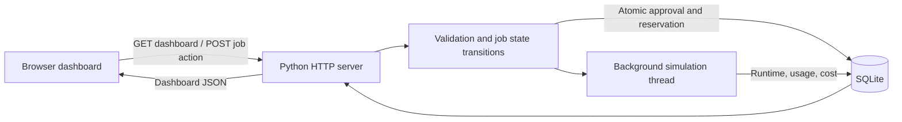

# ComputeLedger — Simulation Budget Manager

A Rescale-inspired portfolio project that helps engineering teams balance compute performance and spending. Teams often approve simulations without knowing how outstanding jobs affect the remaining budget. ComputeLedger estimates costs before submission, reserves funds at approval, and reconciles actual charges after execution, including failed runs.

## Run locally

Requires Python 3.9+; no pip packages or cloud accounts needed.

```sh
python3 app.py
```

Open http://localhost:8000. SQLite is created automatically with three projects, an example user, and 18 historical jobs. Stop with Ctrl+C. To use a fresh database without deleting your existing data:

```sh
BUDGET_DB=fresh-demo.db PORT=8001 python3 app.py
```

## Walkthrough

1. Click **Submit a job**. Enter baseline CPU hours, completion target, project, and configuration. The form compares eligible configurations and estimates runtime and cost.
2. Submit for approval. Pending requests do not reserve money.
3. Click **Approve** to reserve the estimated charge. Approval is blocked if the available project budget is insufficient; **Reject** closes the request.
4. Click **Run job**. A simulated execution completes in approximately five seconds. Enable “Simulate a failed run” during submission to explore failure accounting.
5. Inspect actual cost, runtime, core-hours, GPU-hours, and simulated GPU utilization. Filter jobs by project or status.

## Architecture



SQL tables: `projects`, `budgets`, `users`, `jobs`, and `costs`. Foreign keys link each job to its project and submitter, each budget to a project, and each actual charge to a job. Approval uses `BEGIN IMMEDIATE` so concurrent approvals cannot reserve the same funds.

Lifecycle: `pending → approved → running → succeeded / failed`; `pending → rejected`.

## Cost and recommendation model

- Estimated runtime = baseline CPU hours ÷ configuration speed multiplier.
- Estimated cost = estimated runtime × hourly configuration rate.
- Actual cost = simulated resource runtime × hourly rate.
- Available budget = allocation − recorded charges − approved/running estimates.
- Core-hours = runtime × allocated CPU cores; GPU-hours = runtime × allocated GPUs.
- Cost per successful job = successful-job charges ÷ successful-job count. Total spending separately includes failed-job charges.
- Form recommendations select the cheapest configuration that satisfies the requested completion target. The dashboard compares a fixed 60-hour example. CPU Balanced costs $96 over 60 hours; GPU Accelerated costs $64 over 20 hours; HPC costs $144 over 30 hours.

Rates, speed multipliers, seed history, GPU utilization, and execution resource hours are illustrative. These are not cloud bills or NVIDIA telemetry. Actual simulated runtime varies between 85–115% of the estimate for successful runs; failed runs consume 45%. Budget overages can occur after execution because approval reserves an estimate. Restarting the server marks interrupted running jobs failed and releases reservations; interrupted runs have no recorded charge.

## Validation

```sh
python3 -m unittest discover -s tests -v
```

Tests cover reservations, budget rejection, invalid numeric inputs, state transitions, and successful/failed usage accounting.

## Screenshots

Start the app, capture the dashboard and submission dialog, and save them as `docs/dashboard.png` and `docs/submission.png`. Browser automation was unavailable during initial development, so verified screenshots are not included yet.

## Scope

This is a local, single-workspace demo with a fixed example user. It has no authentication, cloud execution, production worker queue, NVML integration, or real billing ingestion. Keep it bound to localhost. Python's development HTTP server is not a production deployment target. Styling falls back to system fonts when Google Fonts is unavailable.

## Publish to GitHub

The project is ready for a repository named `simulation-budget-manager`. With GitHub CLI installed and authenticated:

```sh
git init
git add .
git commit -m "Build simulation budget manager"
gh repo create simulation-budget-manager --source=. --private --push
```

## Inspiration and resources

Rescale's recommendation engine explores compute configurations to balance cost and performance; this project implements a much simpler deterministic comparison, not Rescale's AI or service.

- [Rescale Compute Recommendation Engine](https://rescale.com/blog/rescales-compute-recommendation-engine-ai-driven-intelligence-for-full-stack-computing/)
- [Rescale CRE overview](https://rescale.com/glossary/compute-recommendation-engine-cre/)
- [NVIDIA NVML](https://developer.nvidia.com/management-library-nvml) — possible future real GPU telemetry integration.
- [CUDA Python](https://nvidia.github.io/cuda-python/) — possible future GPU workload execution.
